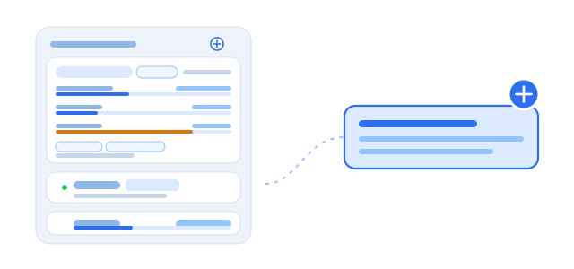

# Model balances

Subscription quotas and account balances for the model providers this profile pays, collected in one right-sidebar tab and exposed to every agent through one tool.

## What it shows

- **GLM Coding Plan** (`api.z.ai` or `open.bigmodel.cn`): the plan tier, one meter row per quota window —
  the **5-hour rolling window**, the **weekly window**, and the **tool-call window** (with a per-tool usage
  breakdown) — each with its usage percentage, used/limit figures, remaining count when the console sends
  one, and a live reset countdown.
- **DeepSeek Platform**: wallet rows per currency with the total available balance, the granted / topped-up
  split, and the green-or-red dot for "sufficient for API calls".
- **OpenRouter**: remaining credits (total credits minus total usage) with a used-versus-total meter.

The panel polls once a minute while open (the Host caches results for 30 seconds), and every card has its
own refresh button. Meters change color at 60% (warning) and 85% (danger) usage.

## Composer-dock gauges

The statistics strip beside the tokens/s and cache-hit pills and the context-occupancy ring shows a pair
of 270° gauges for the GLM account the **current session** actually runs on: the shaded arc spans the
window's used percentage (read exactly like the context ring), while the percentage number next to it
takes the threshold colors (warning at 60%, danger at 85%). Clicking one opens a panel — portaled above
the strip — with used/limit, remaining, and reset countdowns. The session names its model route through
the durable `modelSelection` projection (for example `zai-coding-cn`); bind accounts to routes with the
account's "Session model routes" field (space-separated, exact match). With no matched route — or before
the session's first model request — the gauges stay hidden, so they never read as a second context ring
and never show unrelated accounts.

## Setup

Open the right sidebar's **Model balances** tab, choose **Add account**, and pick a provider:

| Provider | Key source | Base URL (default) |
|---|---|---|
| GLM Coding Plan | [z.ai API keys](https://z.ai/manage-apikey/apikey-list) | `https://api.z.ai` (mainland consoles: `https://open.bigmodel.cn`) |
| DeepSeek Platform | [platform.deepseek.com](https://platform.deepseek.com/api_keys) | `https://api.deepseek.com` |
| OpenRouter | [openrouter.ai](https://openrouter.ai/settings/keys) | `https://openrouter.ai` |

Any coding-plan key works for GLM — the same key you configured for Claude Code or other agent tools.
Instead of pasting a key, you can name an environment variable (for example `ZAI_CODING_CN_API_KEY`); it
is read on the Host at query time and a stored key wins over it. Several accounts per provider are fine;
disabled accounts stay configured but are not queried.

## Agent tool

Agents call `balance_query`:

- without arguments it returns every enabled account's normalized numbers;
- `account` (id or display name) narrows the answer to one account;
- `refresh: true` bypasses the short cache.

Results are cached 30 seconds (errors 15 seconds), so panel polling and agent calls share one request burst.

## Where data lives

Accounts (provider, display name, optional base-URL override, API key) sit in
Accounts need no manual key entry: the plugin reads the model keys DSH already has — `llm-pi-ai/<route>` credential records and the standard credential references (DEEPSEEK_API_KEY, GLM_CODING_PLAN_API_KEY, ZAI_*, OPENROUTER_API_KEY) — maps them to GLM / DeepSeek / OpenRouter and queries directly. Auto accounts carry an "auto" chip and are read-only; an enabled manual account for the same provider wins.

`~/.dsh/model-balance/accounts.json`, written atomically with 0600 permissions. Removing the plugin leaves
that file in place; deleting an account in the panel deletes its stored key with it.

## Security notes

- API keys are stored only on the Host side and are never sent to the browser — the panel receives a
  `…last4` tail only, and the tool answer carries no key material. A key can also come from an environment
  variable named per account (`apiKeyEnv`); only the variable name is written to disk.
- The browser never talks to provider consoles directly; all queries run on the Host and reach the page
  through this bundle's same-origin `/plugins/model-balance` routes.
- Requests go out as `Authorization: Bearer <key>`, with one automatic retry using the bare key when a
  console answers 401/403 (both spellings occur across these consoles).

## Known limitations

- The GLM quota endpoint (`/api/monitor/usage/quota/limit`) is the console's own endpoint and is not part
  of the provider's published API reference; its fields can change without notice. Unknown window shapes
  are still shown (label "Other window") instead of being dropped.
- The weekly window exists on current plans; legacy plans omit it, and its reset timestamp may be absent.
- The 5-hour window is "dynamically refreshed": the console reports a percentage and reset time, not a
  token total, so that row shows a percentage bar without used/limit figures.
