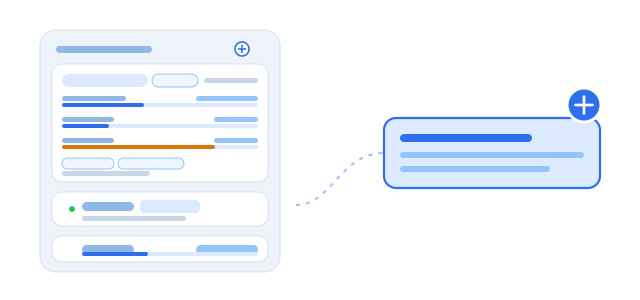

# 模型余额

把本 profile 正在付费的各模型服务商套餐额度与账户余额，集中到右侧栏的一个页签里，并通过一个工具开放给所有智能体。

## 展示内容

- **GLM Coding Plan**（`api.z.ai` 或 `open.bigmodel.cn`）：套餐档位，以及每个额度窗口一行的仪表——
  **5 小时滚动窗口**、**每周窗口**、**工具调用窗口**（附分工具用量明细），各自带用量百分比、
  已用/总量、控制台返回时的剩余次数，以及实时重置倒计时。
- **DeepSeek 开放平台**：按币种的钱包行，含可用余额、赠送 / 充值拆分，以及"可继续调用"的红绿状态点。
- **OpenRouter**：剩余额度（总额度减已用），附已用进度条。

面板打开时每分钟轮询一次（Host 侧结果缓存 30 秒），每张卡片都有独立的刷新按钮。用量达到 60%
进度条变警示色、85% 变危险色。

## 输入框下方的额度仪表

统计条（tokens/s、缓存命中、上下文占用圆环旁边）会为**当前会话所用 GLM 账号**显示一对 270°
弧形仪表：**深色阴影弧的占比即该窗口的已用百分比**（与上下文圆环同一读法），旁边的百分比数字按
阈值变色（≥60% 警示黄、≥85% 危险红）；点击打开面板，查看已用/总量、剩余与重置倒计时。会话通过
其模型路由（`modelSelection` 投影里的 provider route，如 `zai-coding-cn`）匹配账号：在账号的
"对应的会话模型路由"字段里填路由 id（空格分隔，精确匹配），没有匹配或该会话尚未发起过模型请求时
不显示，避免与上下文圆环混淆、也不展示无关账号。

## 配置方法

打开右侧栏的**模型余额**页签，点击**添加账号**并选择服务商：

| 服务商 | 密钥来源 | 基础地址（默认） |
|---|---|---|
| GLM Coding Plan | [z.ai API 密钥页](https://z.ai/manage-apikey/apikey-list) | `https://api.z.ai`（大陆控制台：`https://open.bigmodel.cn`） |
| DeepSeek 开放平台 | [platform.deepseek.com](https://platform.deepseek.com/api_keys) | `https://api.deepseek.com` |
| OpenRouter | [openrouter.ai](https://openrouter.ai/settings/keys) | `https://openrouter.ai` |

GLM 使用任意 Coding Plan 密钥即可——就是你在 Claude Code 等智能体工具里配置的同一把。除了直接粘贴密钥，
也可以只填环境变量名（例如 `ZAI_CODING_CN_API_KEY`），查询时由 Host 进程读取该变量；已保存的密钥优先于
环境变量。同一服务商可以保存多个账号；停用的账号保留配置但不发起查询。

## 智能体工具

智能体调用 `balance_query`：

- 不带参数时返回所有已启用账号的标准化数据；
- `account`（账号 id 或显示名）只查一个账号；
- `refresh: true` 绕过短期缓存。

结果缓存 30 秒（失败结果 15 秒），面板轮询与智能体调用共享同一次请求。

## 数据位置

账号**无需手动添加**：插件自动读取 DSH 已配置的模型密钥，按路由/凭证引用映射到 GLM、DeepSeek、OpenRouter 直接查询，面板中以「自动」徽标标注且不可编辑；已手动添加的同厂商账号优先。

账号信息（服务商、显示名、可选基础地址覆盖、API 密钥）保存在 `~/.dsh/model-balance/accounts.json`，
原子写入且权限为 0600。移除插件不会删除该文件；在面板里删除账号会连同其密钥一起删除。

## 安全说明

- API 密钥只保存在 Host 侧，绝不下发到浏览器——面板只收到 `…末4位`，工具返回也不含任何密钥内容。
  密钥也可以来自账号指定的环境变量（`apiKeyEnv`），磁盘上只写变量名本身。
- 浏览器从不直接访问服务商控制台；所有查询都在 Host 上发起，并通过本插件的同源
  `/plugins/model-balance` 路由送达页面。
- 请求以 `Authorization: Bearer <key>` 发出；当控制台返回 401/403 时，自动以裸密钥重试一次
  （不同控制台对两种写法的接受程度不一）。

## 已知限制

- GLM 额度端点（`/api/monitor/usage/quota/limit`）是控制台自用端点，不在官方公开 API 文档中，字段
  可能随时变化。未知形态的窗口仍会显示（标签为"其他窗口"），不会被静默丢弃。
- 每周窗口只存在于新套餐；老套餐没有该项，且其重置时间可能缺失。
- 5 小时窗口为"动态刷新"：控制台只给百分比与重置时间，没有 token 总量，因此该行只显示百分比进度条。
